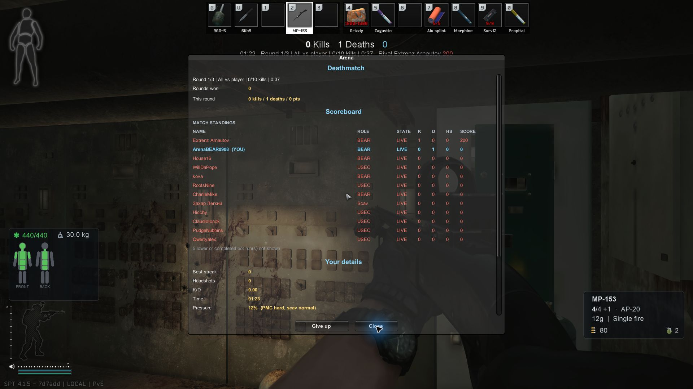
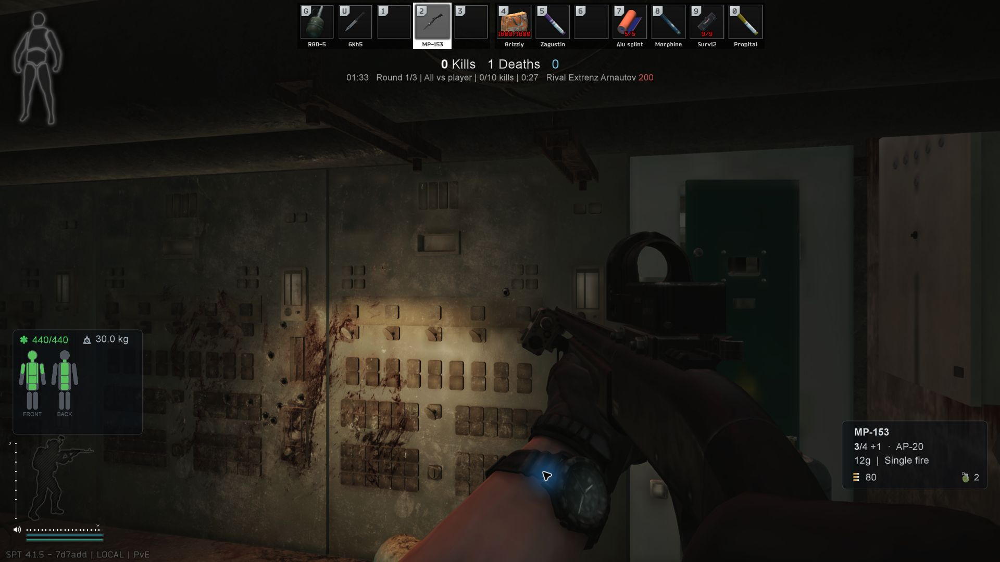

# GPU-Abnahme Deathmatch-Menü/Ausstieg r4 — FAIL, vorgeschriebener Gesamtstopp

Test-ID `deathmatch-menu-exit-r4`, 12.09.2026, Installation `C:\SPT41`.
Auftrag: `GPU-DEATHMATCH-MENU-TEST-INSTRUCTIONS-r4.md`, nach AGENTS.md und aktuellem HANDOFF geprüft.

**R4-01: Der zweite bewusste F9-Close-Klick löste einen Schuss aus.** Die MP-153 zeigte unmittelbar vorher `4/4 +1`, unmittelbar nach dem Klick `3/4 +1` AP-20. Zwischen diesen Beobachtungen gab es ausschließlich den einzelnen Close-Klick, keine weitere Schuss-, Bewegungs-, Nachlade- oder Waffenwechselbedienung. Die Waffe zeigte auf eine Wand, kein Bot im Ziel. Damit ist die unbestätigte r3-Beobachtung auf dem r4-Client reproduziert. Gesamtstopp in Runde 1; danach ausschließlich regulärer Ausstieg, Sicherung und Rückstellung. B und C wurden nicht gestartet.

Beim anschließenden manuellen Ausstieg trat der SAIN-Schutzpfad einmal ohne Exception auf. Der historische Ausstieg nach drei abgeschlossenen Runden sowie der terminale Banner-Fix sind dadurch **nicht abgenommen**.

## Tatsächlicher Teststand

| Merkmal | Stand |
|---|---|
| Branch | `fix/deathmatch-r3-exit` |
| Git-HEAD vor Test | `c956705d84a6c368c519f2853ac8c8545ff7a030` — späterer Dokumentationsstand |
| Source/Build | `39bd7882713da14afcc2432cad092a6c9e1919f6` |
| Client ProductVersion | `0.1.0+39bd7882713da14afcc2432cad092a6c9e1919f6` |
| Spiel | PID 13944, Start 14:06:02.896 UTC / 16:06:02.896 MESZ |
| Server | PID 13720, Start 14:03:14.274 UTC / 16:03:14.274 MESZ |
| Launcher | PID 5680, Start 14:04:34.831 UTC |
| Auflösung | 1920 × 1080, native Spielaufnahmen |
| Profil | Vorhandenes BEAR-Testprofil, solo, keine PFT-Gruppe |
| Raids | Genau 1; Runde 1 bis Gesamtstopp aktiv geprüft, Runde 2 während Ausstieg erreicht; Runde 3 nicht erreicht |

Vor Start, unmittelbar vor Raid A und nach Clientende stimmen alle vier SHA256-Werte überein. Kein Build, DLL-Tausch oder Produktionscode geändert.

| Installierte Datei | SHA256 in allen drei Prüfungen |
|---|---|
| `BepInEx/plugins/maschine-ArenaMode.Client.dll` | `9D27F9A0EA9F76805E33F3F9FF5CBA2AF8821A4C210CFB6822EDA8EDD6090BD9` |
| `SPT_Runtime/user/mods/ArenaMode/maschine-ArenaMode.Server.dll` | `294635440FD1E788B06B708DFFC4912222AD7539E79EEB6524C1E2E8F56BF7E7` |
| `BepInEx/plugins/maschine-Redeploy.Core.dll` | `FDA836C30247B01E1B3E2B19A9749DCA23FAF68C7B3A03CA5D5C35537BB8C7A8` |
| `BepInEx/plugins/SAIN/SAIN.dll` (4.5.1.0) | `C8942B646463283D1247B5673D018C1D3F2EDFBE754A06061CB33BD09C368489` |

Alle drei Programme waren vor dem Test geschlossen; sie wurden für den Durchlauf gestartet und anschließend wieder beendet. Der Launcher benötigte sein eigenes Arbeitsverzeichnis. Der Spielstart mit dem gelieferten Client war erfolgreich.

## Ergebnisse je Unterfall

| Fall | Ergebnis | Beobachtung / Grenze |
|---|---|---|
| A: native Arena-Auswahl und kurze Vorschau | PASS | Arena separat wählbar, vollständige BEAR-Vorschau in Charakter-/Bestätigungsansicht; kein vollständiger erneuter Menüzyklus-Test. |
| A: Factory Tag und Regeln | PASS | Deathmatch / All vs player / 3 Runden / 10 Kills / 120 s. Im Raid `Round 1/3`, `All vs player`, `0/10 kills`, laufender Zweiminutentimer. |
| A: natürliche Todes-/Respawn-Stichprobe | PASS | Ein natürlicher Tod durch einen BEAR-Bot; anschließend lebend mit MP-153, 440/440 HP. Kein Give up oder künstlicher Tod. |
| A: Close-Klick 1 | PASS, einzelne Stichprobe | MP-153 `4/4 +1` vor und unmittelbar nach Close unverändert. |
| A: Close-Klick 2 | **FAIL R4-01** | MP-153 `4/4 +1` → `3/4 +1`; reproduzierter Schuss, Gesamtstopp. |
| A: Close-Klick 3 und gezielte Hotkey/Escape-Schließprüfung | OFFEN | Nach reproduziertem Schuss nicht mehr durchgeführt. Escape bei der Bereinigung zählt nicht als Abnahme dieses Unterfalls. |
| A: alle drei Runden und terminaler Autoexit | OFFEN | Nach Stopp regulär verlassen. Runde-1-Zeitlimit und Runde-2-Start liefen während der Bereinigung; kein Fortsetzen der Abnahme. |
| A: terminales F9-Ergebnis lesbar, kein großes Banner darüber | OFFEN | Letztes Ergebnis nicht erreicht. |
| A: Banner beim Schließen, F9 beim Wiederöffnen | OFFEN | Terminaler Zustand nicht erreicht. |
| A: früheres Vorbereitungsbanner mit F9 erhalten | OFFEN | Kein gezielter Vorbereitungsbanner-Vergleich vor Stopp. |
| A: Autoexit-Countdown ohne Neustart/Verlängerung | OFFEN | Kein terminaler Countdown. |
| A: Score über Ergebnisdauer eingefroren | OFFEN | Keine zeitlich getrennten terminalen Ergebnisbelege. |
| A: regulärer manueller Ausstieg nach Gesamtstopp | PASS | Escape → Disconnect → Confirm Leave → nativer Endscreen → Main Menu; Hauptmenü vollständig bestätigt. |
| A: Logdelta dieses manuellen Ausstiegs | PASS, begrenzt | Keine neue Exception; SAIN-Guard tatsächlich 1×. Nicht der historische dreirundige Autoexit. |
| A: Pickup-Cancel-Schutz tatsächlich ausgeführt | OFFEN | Marker 0×; Pfad in diesem Lauf nicht beobachtet. |
| A: PMC-/Scav-Profilschutz | PASS | Alle geforderten Schutzfelder unverändert; vollständiger JSON-Abgleich siehe unten. |
| B: FFA 1 Runde / Kills Off / 120 s | OFFEN | Wegen Gesamtstopp nicht gestartet. Regeln, Killfeed, Scoreboard, Sieger/Grund und Return-to-menu-Button nicht abgenommen. |
| C: FFA Endless / beide Limits Off, etwa 90 s | OFFEN | Nicht gestartet; Continuous-Verhalten, Give up/Respawn und dessen Ausstieg nicht abgenommen. |
| Normaler PMC-Weg bis vor Ready | OFFEN | Nach Gesamtstopp nicht als weiterer Test durchgeführt. |
| Hideout / Weapon Builder / fremde Körperteile | OFFEN | Nach Gesamtstopp nicht geöffnet. |
| Vier separat gelieferte Refinements | NICHT IM UMFANG | Keine Abnahme von DynamicMaps-Leichenmarkern, Luftsprung, Gitter-Nähe oder DLSS-Markern. |

Bei der Vorbereitung blieb eine endliche Rundenwahl mit beiden Limits Off zunächst auf Endless. Nach Wahl von Kill- und Zeitlimit ließ sich 3 regulär einstellen; der dokumentierte endgültige Regelstand war korrekt.

## R4-01: unmittelbare Belege und Eingabefolge

Alle Zeiten dieser Tabelle UTC; für Client-MESZ jeweils zwei Stunden addieren. Bildzeiten sind Archivierungszeiten unmittelbar nach der zurückgegebenen Aufnahme. Eingabe-/Rückgabegrenzen stehen separat in `input-actions.json`.

| Ereignis | Zeit UTC | Nachweis |
|---|---|---|
| Erster Vergleich, F9 offen nach Respawn | 14:13:46.568 | MP-153 `4/4 +1`, 440/440 HP, Wand im Ziel |
| Erster Close, unmittelbares Nachbild | 14:14:01.803 | MP-153 weiterhin `4/4 +1` |
| F9 für zweiten Vergleich wieder geöffnet | Eingabe 14:14:12.940; Rückgabe 14:14:15.450 | MP-153 `4/4 +1`, gleicher Ort und gleiche Waffe |
| Zweiter einzelner Close-Klick, x=1042/y=906 | **14:14:23.376** | Einziger Input seit vorherigem F9-Öffnen |
| Unmittelbare Rückgabe / Nachbild | **14:14:25.727 / 14:14:25.740** | **MP-153 `3/4 +1`**, F9 geschlossen; neuer Einschlag an der Wand sichtbar |
| Gesamtstopp festgehalten / Escape zur Bereinigung | 14:14:42.474 / 14:14:42.631 | Keine weitere Schussbedienung und kein weiterer Abnahmefall |

Der zweite Vorher-/Nachher-Bildabstand beträgt rund 10,3 s; davon liegen rund 2,35 s zwischen Close-Eingabe und unmittelbar folgender Zustandsrückgabe. Es gab keine intervenierende Bedienung und keinen Tod/Respawn/Waffenwechsel zwischen diesen beiden Bildern. Keine Auswertung eines zeitlich entfernten späteren Munitionsstands. Die Aussage beruht auf sichtbarer Munition und Eingabefolge, nicht auf einer Audioaufnahme.

Vor dem reproduzierenden Klick:

Unmittelbar danach:

## Ausstieg, Logdelta und Schutzmeldungen

Der erste Disconnect-Versuch bei 14:14:54.252 UTC fiel mit dem Rundenwechsel zusammen; die nächste Aufnahme zeigte F9 und `Round 1: target missed — Time limit — next in 14s`. Nach erneuter Beobachtung führte Escape wieder zum Pause-Menü; der zweite Disconnect öffnete den nativen Confirm-Leave-Bildschirm. Keine interne Exit-Funktion aufgerufen und keine Testregeln verkürzt.

| Marker | UTC | Client MESZ / Quelle |
|---|---|---|
| Runde 1 gestartet, nach abgeschlossenem Startkit | 14:12:51.539 | 16:12:51.539, Client |
| Natürlicher Tod / abgeschlossener Respawn | 14:13:14.125 / 14:13:33.532 | Client meldet 19,40 s Respawn, davon 18,44 s Bundleladen; anschließend visuell bestätigt |
| Runde 1: Zeitlimit, target missed | 14:14:53.528 | 16:14:53.528, Client |
| Runde 2 gestartet, Bereinigung bereits aktiv | 14:15:09.366 | 16:15:09.366, Client |
| Confirm Leave geklickt | 14:15:46.165 | 16:15:46.165, Eingabeprotokoll |
| Session-Ende / Match-Ende | 14:15:49.529 / .537 | 16:15:49.529 / .537, Client |
| Profil wiederhergestellt | 14:15:49.687 | Server UTC |
| Protected end abgeschlossen | 14:15:49.770 | Server UTC |
| Nativer Endscreen aufgenommen | 14:16:12.470 | Left the Action, Raidzeit 00:03:01, EXP 0 |
| Main Menu geklickt | 14:16:21.828 | Eingabeprotokoll |
| Vollständiges Hauptmenü aufgenommen | 14:17:47.237 | Originalbild, erst danach Profilvergleich |

| Schutzmeldung | Anzahl | Zeitpunkt / Bewertung |
|---|---:|---|
| `Arena: optional SAIN 4.5.1 uninitialized-component teardown safeguard ready.` | 1 | 16:06:24.791 MESZ / 14:06:24.791 UTC, Clientzeile 4968; Bindung bereit. |
| `Arena bot teardown: cancelled pending native pickup before disposal.` | 0 | Pfad nicht beobachtet; kein Schutz-Nachweis. |
| `Arena SAIN teardown: uninitialized Arena component; coroutine cleanup retained.` | 1 | 16:15:49.847 MESZ / 14:15:49.847 UTC, Clientzeile 13331; Schutzpfad bei manuellem Ausstieg ausgeführt. |

Frischer Client bis bestätigtem Hauptmenü: 13.337 Zeilen im unabhängigen Audit; die abschließende Rohkopie umfasst 13.610 physische Zeilen. **Keine neue Error/Fatal-Meldung und keine geworfene Exception**, insbesondere kein BotItemTaker/CG_PickupAction-ArgumentException und kein SAIN-OnDisable-NRE. Deshalb existiert in diesem Durchlauf kein relevanter Exception-Stack zum Abdrucken. Bekannte Start-/Lade-/Culling-Warnungen getrennt bewertet. Serverfenster nur ab dem tatsächlichen Prozessstart ausgewertet; frühere Tageslogs nicht diesem Lauf zugerechnet. Vollständige Rohlogs bleiben privat in `artifacts/`.

Diese Beobachtung belegt den einen erreichten manuellen Teardown. Sie ist keine pauschale Freigabe unbekannter SAIN-Komponenten, fehlender BotOwner-Zuordnungen oder des abgebrochenen dreirundigen Autoexit-Falls.

## Raidweiser Profilvergleich

Private, ausschließlich gelesene Kopien: A-vorher **14:11:43.217 UTC**, A-nachher **14:17:57.841 UTC**, nach sichtbarer Hauptmenürückkehr. Unabhängiger rekursiver Vollvergleich mit erhaltenen Arrayreihenfolgen und Datentypen. Keine Profile bearbeitet oder zurückkopiert.

| Feld | PMC | Scav |
|---|---|---|
| Inventory | PASS, identisch | PASS, identisch |
| Quests | PASS, identisch | PASS, identisch |
| Skills | PASS, identisch | PASS, identisch |
| Health, einschließlich UpdateTime | PASS, identisch | PASS, identisch |
| Info.Experience | PASS, 0 → 0 | PASS, 0 → 0 |
| Info.Level | PASS, 1 → 1 | PASS, 1 → 1 |
| TaskConditionCounters | PASS, identisch | PASS, identisch |
| RepeatableQuests | PASS, identisch | PASS, beidseits nicht vorhanden |

**Vollständiges JSON:** exakt eine Differenz: `characters.pmc.Hideout.sptUpdateLastRunTimestamp` **1789222283 → 1789222643**, entsprechend **14:11:23 → 14:17:23 UTC (+360 s)**. Alle anderen Werte und das gesamte Scav-Profil sind identisch. Dies ist der bekannte Hideout-Aktualisierungszeitstempel; der Dateivergleich allein identifiziert seinen Schreiber nicht. Kein Inventar-/EXP-/Gesundheitsgewinn oder -verlust. Die native EXP-Anzeige wurde nicht als Persistenznachweis verwendet.

Vorlauf separat: Zwischen initialer Kopie und Raidbaseline änderten sich bereits `PMC.Health.UpdateTime` **1789215971 → 1789222014** (12:26:11 → 14:06:54 UTC) und der Hideout-Zeitstempel **1789217639 → 1789222283** (12:53:59 → 14:11:23 UTC). Sonst auch dort keine Differenzen. Diese beiden Änderungen liegen vor Raid A und werden ihm nicht zugerechnet.

## Einstellungen, Zeitbudget und Abschluss

| Eigener Testwert | Vorher | Raid A | Regulär zurückgestellt |
|---|---|---|---|
| Match/GameMode | gungame | deathmatch | gungame |
| Deathmatch/Rounds | 0 | 3 | 0 |
| Deathmatch/KillLimit | 0 | 10 | 0 |
| Deathmatch/TimeLimitSeconds | 0 | 120 | 0 |
| Deathmatch/FreeForAll | true | false | true |

Rückstellung ausschließlich im nativen Arena-Regelmenü, kein weiterer Raid. Alle **147** ursprünglichen Arena-Konfigurationswerte stimmen am Ende überein. `SkipPreRaidScreens=true` blieb durchgehend erhalten; kein F12-Wert geändert. Control.ini, Graphics.ini, RaidInfoPanels.cfg und Server-config.json sind byteidentisch. Die Arena-CFG änderte lediglich den vom neuen Client erzeugten Beschreibungskommentar zu DoubleJumpEnabled; der Wert blieb gleich. In `client-settings.json` änderten sich derselbe Beschreibungstext und `UpdatedAt` (14:52:17 → 16:19:36), keine Eintragswerte. Kein Anlass, diese Metadaten zurückzukopieren. Alle **33** erfassten Arena-Assetdateien, einschließlich Audio, sind byteidentisch.

Die Grenze wurde vorsorglich als **20 Minuten verstrichene Zeit ab erster nativer Spielmenü-Testeingabe** geführt, einschließlich aller anschließenden Lade-, Werkzeug-, Beobachtungs- und Bereinigungsfenster. Start **14:10:22.932 UTC**, Deadline **14:30:22.932 UTC**. Gesamtstopp 14:14:42.474; Hauptmenübild 14:17:47.237; Rückstellung bestätigt 14:20:12.330; Spiel regulär beendet, Launcher geschlossen, eigener Server beendet und Abschlussstand 14:22:31.260. Damit konservative Obergrenze bis abgeschlossener Bereinigung **12 min 8,328 s**, klar unter 20 Minuten. Berichtserstellung danach ist kein weiterer Live-Test.

Getrennte Ladebeobachtungen: Spielstart vor Testclock 14:06:02.896 bis Hauptmenü spätestens 14:09:57.549. Raid-Ready 14:11:54.203; noch Ladebild 14:12:26.651; erstes aufgenommenes Live-Bild 14:13:06.612. Rückweg: Confirm Leave 14:15:46.165, Endscreen spätestens 14:16:12.470; Main-Menu-Klick 14:16:21.828, noch Ladebild 14:16:37.226, vollständiges Menü spätestens 14:17:47.237. Diese Intervalle enthalten Beobachtungs-/Werkzeuglücken und sind **keine exakten Ladezeiten**; für die Unter-20-Minuten-Grenze wurde nichts davon abgezogen.

Belege: **20 unveränderte Originalbilder** und gezielte Prüfdaten unter [test-evidence/deathmatch-menu-exit-r4/2026-09-12T14-00-41-576Z](test-evidence/deathmatch-menu-exit-r4/2026-09-12T14-00-41-576Z/), mit SHA256-Manifest. Rohlogs, vollständige Profile und weitere Originalbilder ausschließlich unter dem ignorierten `artifacts/gpu-deathmatch-menu/deathmatch-menu-exit-r4/2026-09-12T14-00-41-576Z/`. Veröffentlichte Logauszüge sind gezielt ausgewählt und private Kennungen redigiert.

Nur dieser Bericht und seine Belege gehören zum Abnahmecommit. r1/r2/r3-Berichte und deren Belege bleiben unverändert. Die schon vorher vorhandene fremde Datei `ArenaMode.Server/defaults/~syncthing~ladder.json.tmp` bleibt unangetastet.
